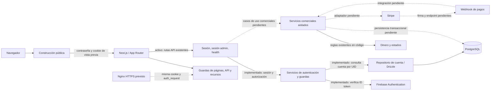

# TriskelWeb

TriskelWeb es la aplicación web oficial de Triskel y la base técnica para una futura tienda y administración. La Home está implementada y permanece detrás de una vista previa privada; la entrada pública es una pantalla de construcción. Las cuentas y varios componentes comerciales tienen una base parcial, pero no existe una tienda operativa ni un despliegue de producción verificado. Este README distingue el código disponible de las integraciones y garantías aún pendientes.

## Estado en un vistazo

| Área | Estado comprobable |
| --- | --- |
| Sitio y vista previa | Pantalla pública de construcción con el símbolo oficial; Home completa accesible tras contraseña y cookie independiente. No hay formulario de contacto, compra ni reproducción incrustada. |
| Sesiones | Hay interfaz de acceso y rutas para iniciar, consultar y cerrar sesión. La conexión con un proyecto Firebase real no está validada. |
| Datos comerciales | Hay esquema Drizzle/PostgreSQL y lógica de dominio para cuentas, catálogo, pedidos, dinero, estados, reservas y eventos. No equivalen a una tienda funcional. |
| API | Las rutas existentes son `GET/POST/DELETE /api/auth/session`, `GET /api/admin/session` y `GET /api/health`. No hay rutas de checkout, pagos, webhooks ni mutaciones de inventario. |
| Operación | Dockerfile, Compose sin puertos de host para aplicación/base y propuesta Nginx HTTPS con `auth_request`. No hay VPS ni despliegue de producción validado. |

## Tecnologías

| Tecnología | Uso actual |
| --- | --- |
| Next.js 15.5.29 y React 19 | Una aplicación App Router sirve la interfaz y las rutas API; permite mantener juntas las páginas públicas y las operaciones servidoras existentes. |
| TypeScript 5 | Tipado del código de interfaz, rutas, servicios y contratos del dominio; `npm run typecheck` ejecuta `tsc --noEmit`. |
| PostgreSQL y `pg` | Base relacional prevista para la fuente de verdad comercial. El esquema modela relaciones e índices; no se ha probado contra una base de producción. |
| Drizzle ORM 0.45 | Define el esquema tipado y el acceso SQL. Las tablas de `src/db/schema.ts` no prueban por sí solas que las migraciones estén aplicadas. |
| Firebase Authentication | Proveedor de identidad. El servidor verifica ID tokens y busca la cuenta interna vinculada; Firebase no almacena el catálogo ni los pedidos. La validación con proyecto real sigue pendiente. |
| Docker y Docker Compose | Dockerfile compila Next.js como aplicación standalone, con Node 26 Alpine y usuario no privilegiado. Compose describe la aplicación y PostgreSQL 17 para un entorno local de ejemplo. |
| Vitest | Ejecuta pruebas unitarias y de rutas con `npm run test`; no acredita por sí solo integración concurrente con PostgreSQL ni un recorrido ecommerce de extremo a extremo. |

## Arquitectura observada

La aplicación está organizada como monolito modular: Next.js aloja la interfaz y las API actuales; los servicios y las reglas puras del dominio separan conceptos comerciales de las rutas. La conexión de sesión observada usa Firebase para verificar identidad y PostgreSQL para localizar una cuenta interna. Los servicios de reservas y eventos tienen contratos para repositorios y transacciones, pero no se debe inferir de ellos que exista una integración PostgreSQL de esos flujos.



Las líneas continuas describen conexiones presentes en el código, incluidos los componentes comerciales aislados; las discontinuas son conexiones pendientes. El diagrama no implica que PostgreSQL esté desplegado, que las reservas estén conectadas a una transacción real ni que Stripe/webhooks estén implementados. [Arquitectura prevista para Next.js y VPS](docs/planning/triskelweb-nextjs-vps-architecture.md) amplía el despliegue propuesto.

## Funcionalidades y fundamentos disponibles

### Organización del código

| Zona | Responsabilidad observada |
| --- | --- |
| `src/app/` | Rutas de página y API bajo App Router. |
| `src/components/` | Componentes de interfaz pública organizados por área, por ejemplo banda, música y perfiles. |
| `src/domain/` | Tipos, importes y reglas puras de estado. |
| `src/services/` | Casos de uso y contratos para autenticación, autorización, reservas y eventos. |
| `src/db/` | Cliente PostgreSQL, esquema Drizzle y repositorios concretos donde existen. |
| `drizzle/` | Migraciones generadas; su aplicación a una base real requiere un paso operativo explícito. |

La API pública es acotada. La ruta de health informa del estado de aplicación y no debe interpretarse como una comprobación integral de dependencias.

### Sitio público

La Home reúne identidad y biografía de la banda, cuatro lanzamientos, vídeo especial, galería, perfiles oficiales y navegación. Los destinos y recursos públicos se documentan en [PRODUCT.md](PRODUCT.md); la dirección artística actual, en [DESIGN.md](DESIGN.md). La tienda se presenta como futura: no procesa compras.

El footer mantiene navegación, contacto informativo, estado legal y acceso de cliente; no contiene logotipo ni eslogan. Se separa de «Sigue a Triskel» mediante una línea de 1 px con centro dorado apagado y extremos transparentes, y agrupa las dos columnas en un contenedor centrado. El título y subtítulo social están centrados; se conservan los siete perfiles oficiales y su distribución responsive. Estos cambios no activan formulario, contacto ni ventas.

### Vista previa privada

**Cierre de seguridad pendiente:** el filtrado Unicode de la utilidad TTY se reprodujo y corrigió; generación y login conservan la entrada UTF-8 exacta, sin recorte ni normalización. Las 32 pruebas focalizadas pasan. El verificador independiente completó 16 comprobaciones, pero su arnés falló antes de completar la protección de sesiones/rutas/recursos. No se repitió esa comprobación. La vista previa no se considera aprobada para entrega final ni producción; TTY real y VPS siguen sin validar.

La entrada `/construccion` utiliza exclusivamente `triskel-simbolo.png`. La contraseña se verifica con scrypt en servidor; una cookie `HttpOnly` firmada, independiente de Firebase, permite navegar durante dos horas. No hay contraseña predeterminada. Configuración ausente o inválida cierra el acceso; el modo público de desarrollo se rechaza en producción.

Las páginas y APIs tienen guardas servidoras, además del middleware. Los originales privados pasan por un handler autenticado antes de la lectura del archivo; sólo el símbolo público se admite en el optimizador. El control de salida elimina la cookie de vista previa, no la sesión comercial. El modelo stateless no revoca individualmente una copia sustraída: expira o se invalida rotando el secreto/hash. Se limitan intentos globalmente por proceso; Nginx deberá reforzarlo por peer real.

Configuración, utilidad TTY sin eco, rotación, excepciones públicas, costes de servir originales y límites operativos: [guía de vista previa privada](docs/setup/private-preview.md). No se promete confidencialidad absoluta de los bundles técnicos públicos ni de archivos descargados previamente.

### Identidad y autorización

`POST /api/auth/session` valida un ID token de Firebase y consulta por UID la relación `CustomerAccount`/`Customer`; la cuenta debe existir previamente. Se emite una cookie de sesión propia con vencimiento predeterminado de siete días y atributos `HttpOnly`, `SameSite=Lax` y, en producción, `Secure`. `GET` informa del estado y `DELETE` cierra la sesión.

Autenticación responde quién es la persona; autorización decide qué puede hacer. Las comprobaciones actuales usan atributos internos como `isAdmin` y correo verificado. Existe un campo `role`, pero esto no constituye RBAC granular ni un sistema de permisos operativos. Hay un helper para autorizar y registrar mutaciones administrativas; no hay rutas comerciales que lo conecten. `GET /api/admin/session` informa del acceso, no es un panel.

El flujo completo con un proyecto Firebase, cuentas vinculadas y pruebas reales de sesión sigue pendiente. Véase la [guía de validación de Firebase](docs/setup/firebase-auth-real-validation.md).

### Base comercial parcial

El esquema incluye clientes y cuentas, productos y variantes, inventario, carritos, pedidos, pagos, envíos, reservas, referencias/eventos externos y auditoría administrativa. Hay relaciones, restricciones únicas e índices definidos en `src/db/schema.ts`. Existe una migración inicial en `drizzle/`; su presencia no demuestra que se haya aplicado a una base de datos.

- **Dinero:** `src/domain/money.ts` representa cantidades como enteros en unidades menores y moneda de tres letras; valida importes no negativos y rechaza sumar monedas distintas. No demuestra que todos los procesos de compra calculen correctamente impuestos o totales.
- **Estados:** `src/domain/state-transitions.ts` declara transiciones permitidas para pedidos, pagos, reservas y envíos: por ejemplo, permite `pending_payment → paid`, pero no `cancelled → paid`; una reserva pasa de `reserved` a `committed`, `released` o `expired`. Las reglas rechazan transiciones inválidas al invocarlas; no se aplican automáticamente a toda escritura persistida ni coordinan todavía pedido, pago y stock en una transacción.
- **Existencias:** `src/services/stock-reservations.ts` expresa reserva, confirmación, liberación y expiración, con cantidades disponibles, reservadas y comprometidas. El repositorio puede ofrecer transacciones, pero estas son opcionales; no hay repositorio PostgreSQL de reservas conectado ni garantía de concurrencia en base de datos.
- **Eventos externos:** `src/services/provider-events.ts` registra eventos a través de un repositorio y evita el reprocesamiento según el resultado `created`. El esquema propone unicidad por proveedor e identificador de evento; no existe una integración de webhook activa ni se ha probado concurrencia contra PostgreSQL.
- **Administración:** hay comprobaciones de sesión y un helper de autorización/auditoría. No hay operaciones de catálogo, pedidos o pagos expuestas como rutas administrativas.

Estos componentes son fundamentos reutilizables, no evidencia de una tienda en funcionamiento. Las entidades comerciales existentes no implican que haya reglas de negocio completas ni una operación de ventas activa.

## Cinco decisiones técnicas

| Problema | Solución | Beneficio para TriskelWeb | Compromiso o límite | Relación con otros componentes |
| --- | --- | --- | --- | --- |
| Mantener interfaz y operaciones del servidor sin desplegar aplicaciones separadas, y detectar cambios incompatibles entre capas. | Next.js App Router y React en una aplicación, con TypeScript y rutas API en el mismo despliegue. | Simplifica el despliegue inicial y hace visibles cambios de contrato durante el desarrollo. | Concentra responsabilidades; TypeScript no valida por sí solo datos externos ni reglas en ejecución. | Las rutas llaman servicios tipados; las reglas del dominio no deberían depender de componentes React. |
| Guardar pedidos y relaciones comerciales con consistencia referencial. | PostgreSQL relacional con Drizzle como esquema y capa de acceso tipada. | Encaja con clientes, variantes, reservas y pedidos relacionados; permite definir índices y claves únicas. | Añade operación de base de datos y gestión de migraciones; el esquema no prueba concurrencia ni integridad de flujos no conectados. | PostgreSQL es la fuente comercial prevista; Drizzle accede a ella y Firebase no sustituye este almacenamiento. |
| Separar autenticación del modelo comercial propio y mantener autorización interna. | Firebase Authentication acredita la identidad; la cuenta y los atributos administrativos se consultan en PostgreSQL. | Evita convertir identidades externas en el modelo de pedidos y conserva la decisión de acceso dentro de la aplicación. | Mantiene dos servicios diferenciados, su configuración, costes y puntos de fallo; la validación real aún falta. | Next.js verifica tokens; el repositorio Drizzle enlaza UID con `CustomerAccount`; el login no concede por sí solo permisos comerciales. |
| Repetir localmente la ejecución y preparar un despliegue autocontenido sin incorporar orquestación. | Dockerfile multi-etapa para Next.js standalone y Compose de ejemplo con PostgreSQL. | Define runtimes y servicios para desarrollo y una futura instancia sencilla. | Compose exige secretos y certificados privados; la imagen y el proxy requieren validación en Linux y las migraciones se gestionan aparte. | La aplicación usa `DATABASE_URL`; secretos Firebase/sesión no están incluidos y no hay migración automática. |
| Probar reglas y contratos cercanos al código sin presentar pruebas aisladas como una tienda integrada. | Vitest para pruebas unitarias y de rutas; `npm run test` ejecuta la suite. | Permite verificar reglas puras, errores y comportamiento de handlers con resultados rápidos y repetibles. | No garantiza por sí mismo persistencia real, carreras concurrentes, E2E, seguridad ni aceptación visual. | Complementa TypeScript y lint; las pruebas de dominio deben ampliarse con PostgreSQL y recorridos de compra cuando existan. |

Estas decisiones permiten evolucionar por módulos sin confundir las reglas ya probadas con una operación comercial completa.

## Verificación

Los scripts registrados en `package.json` son la interfaz de verificación del repositorio. Las comprobaciones siguientes no requieren migrar una base ni acceder a servicios reales.

Comandos declarados en `package.json`:

```bash
npm ci
npm run typecheck
npm run lint
npm run test
npm run build
```

**Resultados de la versión actual:** `npm run typecheck` y `npm run lint` finalizaron con código 0; `npm run test` aprobó **193 pruebas en 29 archivos**. La suite cubre dominio, servicios y handlers aislados, además de contenido y reglas de interfaz. No sustituye pruebas integradas con servicios reales.

`npm run build` compiló en una copia aislada y finalizó con código 0, pero el paso de empaquetado standalone quedó bloqueado por `EPERM` al crear un enlace de dependencias. También se observó advertencia de raíz por varios lockfiles y aviso de Node `DEP0190`; estos asuntos no se consideran resueltos. La aplicación no tiene un build de despliegue standalone verificado.

La inspección de la Home a 1440, 1024, 768, 390 y 320 px comprobó el footer, el separador degradado, la escala del título social, los siete destinos y la ausencia de desbordamiento. Se conservaron la geometría del hero, Biografía, portadas y Galería, y los recursos y enlaces musicales. La revisión de hover/foco fue de estilos CSS, no una validación interactiva completa de teclado.

npm run test:preview ejecuta comprobaciones HTTP de integración en un entorno aislado, utilizando un servidor de desarrollo temporal y credenciales sintéticas. Las pruebas locales cubren autenticación autorizada y denegada, sesiones manipuladas o caducadas, cierre de sesión, protección de páginas, APIs y recursos, así como comprobaciones de exposición de credenciales en registros y bundles cliente.

Estas verificaciones no sustituyen una auditoría independiente completa ni la validación del despliegue de producción. Permanecen pendientes la comprobación real de Nginx y HTTPS en el VPS, las integraciones con servicios externos y una auditoría integral de accesibilidad. Véase el backlog de implementación para los criterios de cada fase.

## Ejecución local

Entorno local de las comprobaciones: Node.js 24.19.0 y npm 11.17.0; Docker declara Node 26 Alpine, cuya ejecución integrada sigue pendiente. `npm ci` instala las dependencias fijadas por el lockfile; no sustituye la configuración de servicios externos. Para iniciar la pantalla de construcción, que no requiere PostgreSQL ni Firebase:

```bash
npm ci
npm run dev
```

Abre <http://localhost:3000>. Para entrar en la Home configura primero los secretos mediante la [guía de acceso privado](docs/setup/private-preview.md); no se incluye una contraseña funcional de ejemplo. Para compilar:

```bash
npm run build
npm start
```

La limitación de empaquetado descrita arriba significa que el resultado standalone no está validado.

Para configurar servicios, copia `env.example` a `.env.local` y completa solo los valores necesarios en el entorno local. No incluyas `.env.local`, `.env.production`, claves privadas, contraseñas ni tokens en Git. La plantilla también muestra variables futuras para Stripe, Correos y SMTP; no indica que esas integraciones estén conectadas. Revisa la [guía de entorno](docs/setup/environment.md) y la [validación Firebase](docs/setup/firebase-auth-real-validation.md).

`docker-compose.yml` requiere credenciales privadas mediante variables obligatorias; sólo publica 80/443 del proxy y mantiene PostgreSQL en una red interna. Necesita certificados TLS privados, revisión de Nginx y validación en Linux. `docker compose config --quiet` pasó con valores sintéticos de validación; no prueba contenedores, TLS ni despliegue. La configuración comercial de Firebase/`SESSION_SECRET` y las migraciones siguen siendo pasos separados. Antes de conectar una base, revisa la configuración y la migración inicial; no hay evidencia de migraciones aplicadas en un entorno real.

## Hoja de ruta

El estado se refiere al código y a la validación conocidos, no a fechas de entrega.

| Fase | Alcance | Estado |
| --- | --- | --- |
| 1. MVP web oficial | Home, identidad visual, contenido y enlaces verificados; revisión de derechos y contenido. | MVP visual aprobado; se conserva bajo acceso privado. Derechos/créditos y preparación jurídica pendientes. |
| 2. Publicación privada | Construcción pública, contraseña, sesión independiente y defensa por capas; futura publicación controlada. | Implementada y probada localmente; Nginx, TLS, empaquetado y operación en VPS pendientes. |
| 3. Registro y cuentas | Validar Firebase real, vincular cuentas y completar alta, gestión de sesión y recuperación. | Parcial: login y puente servidor existen; proyecto real, creación/vinculación y flujo E2E pendientes. |
| 4. Catálogo y variantes | CRUD de productos, variantes, imágenes, disponibilidad y stock desde administración. | Parcial en esquema; API, UI y operaciones pendientes. |
| 5. Panel administrativo | Colas, permisos por operación, mutaciones auditadas y gestión comercial. | Parcial: sesión/helper de autorización y esquema de auditoría; panel, permisos granulares y rutas pendientes. |
| 6. Carrito y pedidos | Checkout de invitado/cuenta, direcciones, snapshots y creación de pedido. | Parcial en modelo de datos; flujo ejecutable pendiente. |
| 7. Reservas y control de stock | Persistencia transaccional, concurrencia, expiración y conciliación con pedidos. | Parcial: servicio con repositorio abstracto y pruebas unitarias; adaptador PostgreSQL y garantía concurrente pendientes. |
| 8. Stripe | Checkout alojado, referencias, pagos, reembolsos y gestión de fallos. | Planificada; no está integrado ni operativo. |
| 9. Webhooks | Verificación de firmas, registro durable, idempotencia bajo concurrencia y actualización de estados. | Parcial en conceptos/servicio; endpoint y garantías de base de datos pendientes. |
| 10. Envíos y devoluciones | Tarifas, operaciones de preparación, Correos, seguimiento, incidencias y devoluciones. | Parcial en esquema y estados; integración y operación pendientes. |
| 11. Seguridad, observabilidad y operación | Secretos, permisos, registros, copias y restauración probada, monitorización, despliegue y recuperación. | Planificada y no verificada en producción. |

Los detalles y criterios de aceptación están en el [backlog técnico](docs/planning/triskelweb-implementation-backlog.md), el [modelo de dominio](docs/planning/triskelweb-domain-model.md) y el [modelo de estados](docs/planning/triskelweb-state-model.md).

## Persistencia y ciclo de cambios

`src/db/schema.ts` describe el modelo que Drizzle conoce, mientras que los ficheros de `drizzle/` representan cambios generados para aplicar explícitamente. Mantener ambos sincronizados y revisar cada migración forma parte del cambio de esquema.

Los scripts disponibles son:

| Comando | Efecto |
| --- | --- |
| `npm run db:generate` | Genera archivos de migración a partir del esquema y la configuración. |
| `npm run db:migrate` | Aplica migraciones a la base indicada por la configuración. |
| `npm run db:studio` | Abre Drizzle Studio para inspeccionar la base configurada. |

Estos comandos no forman parte de la suite de calidad. `drizzle.config.ts` lee `DATABASE_URL` del proceso y tiene una conexión local de ejemplo como alternativa: proporciona explícitamente la variable al ejecutar Drizzle, sin asumir que carga `.env.local` como Next.js. Revisa siempre la base de destino antes de una migración; la existencia de una migración inicial no acredita que esté aplicada.

El modelo conserva referencias internas a proveedores en tablas separadas. Cuando se añadan operaciones de pago o envío, los adaptadores deberán traducir eventos verificados a transiciones de dominio y persistir cambios dentro de límites transaccionales definidos. Esa integración aún es trabajo pendiente, no una garantía actual.

## Límites antes de producción

- Validar Firebase contra un proyecto real y recorrer autenticación, vinculación de cuenta, cookies y autorización.
- Implementar repositorios y operaciones comerciales, ejecutar migraciones de forma controlada y probar límites transaccionales y concurrencia en PostgreSQL.
- Construir checkout, pagos, webhooks verificados, panel, envíos y tareas operativas; Stripe no está activo.
- Revisar configuración de secretos, Docker, red, almacenamiento, copias con restauración, monitorización y respuesta ante fallos.
- Resolver textos y datos legales definitivos y derechos de publicación; validar la protección de vista previa, proxy y TLS en el host real antes de publicar.
- Completar pruebas E2E, seguridad, accesibilidad con teclado y contraste global; no se declaran realizadas.

La [preparación legal y de privacidad](docs/planning/legal-privacy-readiness.md) registra decisiones y comprobaciones pendientes; no es asesoramiento ni una certificación de cumplimiento. La [arquitectura propuesta](docs/planning/triskelweb-nextjs-vps-architecture.md) es una guía de objetivo, no una descripción de infraestructura desplegada.

## Documentación relacionada

- [Producto y contenido verificado](PRODUCT.md)
- [Diseño y continuidad visual](DESIGN.md)
- [Decisiones del MVP](docs/planning/triskelweb-mvp-decisions.md)
- [Arquitectura Next.js y VPS](docs/planning/triskelweb-nextjs-vps-architecture.md)
- [Modelo de dominio](docs/planning/triskelweb-domain-model.md)
- [Modelo de estados](docs/planning/triskelweb-state-model.md)
- [Backlog de implementación](docs/planning/triskelweb-implementation-backlog.md)
- [Vista previa privada y despliegue protegido](docs/setup/private-preview.md)
- [Variables de entorno](docs/setup/environment.md)
- [Validación real de Firebase Auth](docs/setup/firebase-auth-real-validation.md)
- [Preparación legal y de privacidad](docs/planning/legal-privacy-readiness.md)
